# AgriPHD 2026 — End-to-End Portal Workflow & Process Guide

> **MCAER Pune — Doctor of Philosophy (Ph.D.) Centralized Admissions Portal**  
> *Architecture: React 18 (TypeScript) + ASP.NET Core 8 API + Dapper + Microsoft SQL Server 2022*

---

## Table of Contents
1. [Executive Overview](#1-executive-overview)
2. [User Roles & Access Control Matrix](#2-user-roles--access-control-matrix)
3. [Chronological Admission Lifecycle (Flowchart)](#3-chronological-admission-lifecycle-flowchart)
4. [Phase-by-Phase Process Breakdown](#4-phase-by-phase-process-breakdown)
   - [Phase 1: Pre-Registration & Candidate Lookup](#phase-1-pre-registration--candidate-lookup)
   - [Phase 2: Account Creation & OTP Verification](#phase-2-account-creation--otp-verification)
   - [Phase 3: The 10-Step Application Wizard](#phase-3-the-10-step-application-wizard)
   - [Phase 4: Fee Calculation & Online Payment Gateway](#phase-4-fee-calculation--online-payment-gateway)
   - [Phase 5: Form Locking, Summary & Appendix-D Print](#phase-5-form-locking-summary--appendix-d-print)
   - [Phase 6: E-Verification Center (EVC) Scrutiny Workflow](#phase-6-e-verification-center-evc-scrutiny-workflow)
   - [Phase 7: Merit List Publication & Grievance Redressal](#phase-7-merit-list-publication--grievance-redressal)
   - [Phase 8: Centralized Allotment Process (CAP Rounds 1 & 2)](#phase-8-centralized-allotment-process-cap-rounds-1--2)
   - [Phase 9: College Reporting & Admission Confirmation](#phase-9-college-reporting--admission-confirmation)
   - [Phase 10: University Spot Round (Institutional Counseling)](#phase-10-university-spot-round-institutional-counseling)
   - [Phase 11: Admission Cancellation & Vacancy Management](#phase-11-admission-cancellation--vacancy-management)
5. [User Role Specific Workflows](#5-user-role-specific-workflows)
   - [Candidate Role (`UserTypeID = 91`)](#candidate-role-usertypeid--91)
   - [E-Verification Center Role (`UserTypeID = 41 / 42`)](#e-verification-center-role-usertypeid--41--42)
   - [College Role (`UserTypeID = 61`)](#college-role-usertypeid--61)
   - [University Role (`UserTypeID = 93`)](#university-role-usertypeid--93)
   - [Administrator Role (`UserTypeID = 12`)](#administrator-role-usertypeid--12)
   - [Super Administrator Role (`UserTypeID = 11`)](#super-administrator-role-usertypeid--11)
6. [System Gatekeeping & Dynamic Configuration Controls](#6-system-gatekeeping--dynamic-configuration-controls)
7. [Reporting & Audit Infrastructure](#7-reporting--audit-infrastructure)

---

## 1. Executive Overview

The **AgriPHD Admissions Portal** manages the complete centralized admission process (CAP) for Doctor of Philosophy (Ph.D.) degree programs across the four State Agricultural Universities (SAUs) of Maharashtra:
1. **MPKV Rahuri** (Mahatma Phule Krishi Vidyapeeth)
2. **PDKV Akola** (Dr. Panjabrao Deshmukh Krishi Vidyapeeth)
3. **VNMKV Parbhani** (Vasantrao Naik Marathwada Krishi Vidyapeeth)
4. **Dr. BSKKV Dapoli** (Dr. Balasaheb Sawant Konkan Krishi Vidyapeeth)

The portal automates candidate registration, CET data validation, online document verification, NAAS research paper weightage calculation, merit ranking, multi-round reservation-based seat allotment, institutional spot counseling, and admission fee/document confirmation.

---

## 2. User Roles & Access Control Matrix

The platform implements strict Role-Based Access Control (RBAC) identified by integer `UserTypeID` stored in the database (`Master_UserType` table):

| UserTypeID | Role Name | System Code | Default Dashboard URL | Target Audience / Scope |
|---|---|---|---|---|
| **0** | **Public User** | `DefaultUser` | `/` (Home) | Prospective candidates, parents, public notices, brochures, cutoffs |
| **91** | **Candidate** | `Candidate` | `/candidate/dashboard` | Applicants filling forms, tracking verification, accepting seats |
| **41** | **EVC Admin** | `EVerificationAdmin` | `/everification/dashboard` | Head of E-Verification Scrutiny Center |
| **42** | **EVC Coordinator** | `EVerificationCoordinator` | `/everification/dashboard` | Scrutiny Officer reviewing uploaded certificates & marks |
| **61** | **College** | `College` | `/college/dashboard` | Agricultural Colleges verifying physical documents & confirming admission |
| **93** | **University** | `University` | `/university/dashboard` | SAU Head Office conducting Spot Round physical counseling |
| **12** | **Admin** | `Admin` | `/admin/dashboard` | Helpdesk, grievance redressal, candidate search, fee refunds |
| **11** | **Super Admin** | `SuperAdmin` | `/super-admin/dashboard` | MCAER Master Control: phase management, activity gates, RBAC menus |

---

## 3. Chronological Admission Lifecycle (Flowchart)

```mermaid
flowchart TD
    subgraph S1["Phase 1 & 2: Pre-Registration & Account Setup"]
        A1["Candidate: Enter PGCET Form No + DOB"] --> A2["Verify Record from Pre-loaded CET Master"]
        A2 --> A3["Send & Verify Mobile/Email OTP"]
        A3 --> A4["Create Password & Generate 9-digit App Form No"]
    end

    subgraph S2["Phase 3 to 5: 10-Step Application Wizard & Payment"]
        B1["1. Personal Details"] --> B2["2. Address & Domicile"]
        B2 --> B3["3. Category & Social Reservations"]
        B3 --> B4["4. Qualification & CGPA"]
        B4 --> B5["5. NAAS Research Papers"]
        B5 --> B6["6. College & Subject Preferences"]
        B6 --> B7["7. Photo & Signature Upload"]
        B7 --> B8["8. Compulsory Document Upload"]
        B8 --> B9["9. Online Fee Payment (Razorpay)"]
        B9 --> B10["10. Final Summary Review & Application Lock"]
    end

    subgraph S3["Phase 6 & 7: E-Verification & Merit Lists"]
        C1["EVC Center Scrutinizes Documents"] --> C2{"Deficiency Found?"}
        C2 -- Yes --> C3["Flag Query / Hold Document"]
        C3 --> C4["Candidate Re-uploads Document"]
        C4 --> C1
        C2 -- No --> C5["Document Verified & Approved"]
        C5 --> C6["Publish Provisional Merit List"]
        C6 --> C7["Grievance Submission & Resolution"]
        C7 --> C8["Publish Final Merit List"]
    end

    subgraph S4["Phase 8 & 9: CAP Rounds & College Admission"]
        D1["Run Automated CAP Seat Allotment (Round 1 / 2)"] --> D2["Candidate Checks Allotment Status"]
        D2 --> D3{"Accept Allotment?"}
        D3 -- Refuse --> D4["Float to Next Round"]
        D3 -- Accept --> D5["Download Allotment Letter"]
        D5 --> D6["Physical Reporting at Allotted College"]
        D6 --> D7["College Verifies Original Certificates"]
        D7 --> D8["College Confirms Admission on Portal"]
        D8 --> D9["College Issues Formal Admission Letter"]
    end

    subgraph S5["Phase 10 & 11: University Spot Round & Closure"]
        E1["Colleges Report Vacant Seats to Universities"] --> E2["University Publishes Dynamic Vacancy Matrix"]
        E2 --> E3["Physical Spot Round Counseling at University Campus"]
        E3 --> E4["University Conducts On-The-Spot Registration & Confirmation"]
        E4 --> E5["Issue Spot Allotment Letter"]
        E5 --> E6["Final Reconciliation & Session Closure"]
    end

    S1 --> S2 --> S3 --> S4 --> S5
```



---

## 4. Phase-by-Phase Process Breakdown

### Phase 1: Pre-Registration & Candidate Lookup
* **Actor**: Candidate (Unauthenticated)
* **URL**: `/register`
* **Workflow**:
  1. Candidate navigates to **New Registration**.
  2. The system checks if registration is active (`GET /api/v1/registration/is-open` via `Base_IsNewCandidateRegistrationStarted`).
  3. Candidate inputs their **PGCET Application Form Number** and **Date of Birth (DOB)**.
  4. The system validates the candidate against pre-loaded CET entrance examination records (`POST /api/v1/registration/lookup` via `ApplicationForm_GetRegisteredCandidate`).
  5. If valid, the candidate's name, gender, entrance exam marks, and discipline are populated automatically. If already registered, the system prompts them to log in.

### Phase 2: Account Creation & OTP Verification
* **Actor**: Candidate (Unauthenticated)
* **URL**: `/register`
* **Workflow**:
  1. Candidate inputs their active **Mobile Number** and **Email Address**.
  2. Candidate sets a secure login password and chooses a **Security Question & Answer** (used for self-service recovery).
  3. Candidate clicks **Send OTP**. The system sends a 4-digit SMS/Email OTP via MSG91 / SendGrid (`POST /api/v1/registration/send-mobile-otp`).
  4. Candidate verifies OTP (`POST /api/v1/registration/verify-otp`).
  5. On successful verification, the candidate profile is created (`POST /api/v1/registration/register` calling `ApplicationForm_RegisterCandidate`).
  6. The system generates a unique **9-digit Application Form Number** (e.g., `252000008`) and displays the **Registration Success** screen.

---

### Phase 3: The 10-Step Application Wizard
* **Actor**: Candidate (`UserTypeID = 91`)
* **URL**: `/candidate/application-form/*`
* **Workflow Steps**:

```
Step 1: Personal Details
  └── Father/Mother name, Gender, DOB, Blood Group, Marital Status
Step 2: Address & Domicile
  └── State (Maharashtra / Other), District, Taluka, Village, Pincode, Domicile status
Step 3: Category & Social Reservations
  └── Category (Open, SC, ST, VJ/DT, NT-B/C/D, OBC, EWS, SEBC)
  └── Sub-reservations: PwD, Orphan, Agriculturist Certificate, Defense, Project Affected (PAP)
Step 4: Academic Qualifications
  └── SSC, HSC, Bachelor's Degree (4-year B.Sc. Agri/Horti/etc.), Master's Degree (M.Sc. with CGPA/OGPA)
  └── PGCET score auto-linked from registration
Step 5: NAAS Research Paper Weightage
  └── Add published research papers in NAAS-rated journals (Journal name, Year, NAAS Score >= 4.0)
  └── System calculates and adds academic weightage points
Step 6: College & Subject Preferences (Option Form)
  └── Shortlist eligible University faculties, departments, and colleges
  └── Order preference priorities (Choice Code 1, 2, 3...) using drag-and-drop
Step 7: Photo & Signature Upload
  └── Upload passport photo (JPEG, 20 KB - 50 KB)
  └── Upload signature scan (JPEG, 10 KB - 20 KB)
Step 8: Compulsory Document Upload
  └── Upload PDF scans of all required certificates:
      - SSC & HSC Marks Sheets
      - Master's Degree Certificate & Transcript (OGPA conversion)
      - Caste Certificate & Caste Validity Certificate (for reserved categories)
      - Non-Creamy Layer (NCL) Certificate (valid for current financial year)
      - Domicile Certificate / School Leaving Certificate
      - Weightage certificates (7/12 extract for agriculturist, sports, NCC/NSS)
```

---

### Phase 4: Fee Calculation & Online Payment Gateway
* **Actor**: Candidate (`UserTypeID = 91`)
* **URL**: `/candidate/application-form/pay-fee`
* **Workflow**:
  1. The system executes `fnCalculateFee` based on:
     - Candidate Social Category (General vs Reserved concessional fee).
     - Domicile (Maharashtra State candidate vs Other State / OMS candidate).
  2. The candidate initiates payment via **Razorpay Payment Gateway**:
     - Standard NetBanking, UPI, Debit/Credit Card options.
  3. Razorpay sends signature webhook / response.
  4. Backend verifies cryptographic HMAC signature (`FeeController.VerifyPayment`).
  5. On success:
     - Payment status is recorded in `Fee_TransactionDetails`.
     - Candidate is assigned an official Payment Receipt with Transaction Reference No.

---

### Phase 5: Form Locking, Summary & Appendix-D Print
* **Actor**: Candidate (`UserTypeID = 91`)
* **URL**: `/candidate/application-form/summary`, `/candidate/application-form/print`
* **Workflow**:
  1. Candidate navigates to **Application Form Summary**.
  2. The system checks validation flags across all previous 9 steps.
  3. Candidate reviews the read-only consolidated declaration.
  4. Candidate clicks **Lock Application Form** (`POST /api/v1/application-form/lock`).
  5. Once locked, the form becomes read-only and transitions to the **E-Verification Queue**.
  6. Candidate prints the **Official Application Form (Appendix-D)** containing embedded candidate photograph, signature, barcoded application number, and submitted preferences.

---

### Phase 6: E-Verification Center (EVC) Scrutiny Workflow
* **Actor**: E-Verification Officer (`UserTypeID = 41 / 42`)
* **URL**: `/everification/dashboard`, `/everification/verify/:candidateId`
* **Workflow**:
  1. EVC Officer logs in and views their allocated queue with status filters:
     - `N` = Not Verified (Freshly locked applications)
     - `H` = On Hold (Deficiencies raised)
     - `P` = Re-Uploaded (Candidate fixed query)
     - `F` = Fully Verified (Approved)
  2. Officer opens candidate verification docket:
     - Side-by-side view: Candidate data on left, uploaded PDF document viewer on right.
  3. For each document:
     - **Approve (`Y`)**: Certificate is valid, clear, matches claimed reservation/marks.
     - **Reject / Hold (`N`/`H`)**: Certificate is blurred, expired (e.g. NCL expired), incorrect authority, or name mismatch. Officer enters mandatory remarks/deficiency reason.
  4. **Deficiency Resolution Cycle**:
     - If any document is rejected, the candidate receives an SMS/Email notification.
     - Candidate logs in to `/candidate/application-form/documents`, sees the officer's exact comments, and re-uploads corrected PDF.
     - The application status changes to `P` (Re-Uploaded).
     - EVC Officer reviews the replacement document and approves it.
  5. Once all compulsory documents are marked `Y`, candidate is marked **Verified & Eligible for Merit List**.

---

### Phase 7: Merit List Publication & Grievance Redressal
* **Actors**: Admin (`UserTypeID = 11/12`), Candidate (`UserTypeID = 91`)
* **URL**: `/reports/generate`, `/admission/allotment-status`
* **Workflow**:
  1. **Provisional Merit List**:
     - Super Admin triggers merit calculation based on:
       `Merit Marks = PGCET Score + NAAS Research Paper Weightage + Sports/Other Weightage`.
     - The Provisional Merit List is published publicly (`/allotment-list`).
  2. **Grievance Window**:
     - Candidates review their category, merit score, and rank.
     - If any calculation error or verification discrepancy exists, candidate submits an online grievance before the cutoff deadline.
  3. **Grievance Resolution & Final Merit List**:
     - Admission Authority resolves grievances.
     - Final Merit List is generated and published. Ranks are permanently locked.

---

### Phase 8: Centralized Allotment Process (CAP Rounds 1 & 2)
* **Actors**: Super Admin (`UserTypeID = 11`), Candidate (`UserTypeID = 91`)
* **URL**: `/admission/allotment-status`, `/admission/allotment-letter`
* **Workflow**:
  1. **Seat Allocation Engine**:
     - Admin activates `PhaseID = 1` (Round-I) or `PhaseID = 2` (Round-II) in `Master_Phase`.
     - The allocation algorithm runs: matches candidate preferences against seat matrix, reservation roasters (SC, ST, OBC, Open, etc.), university quotas (Home University vs Other University quota), and candidate merit rank.
  2. **Candidate Seat Notification**:
     - Candidate logs in and opens **Check Allotment Status**.
     - If allotted: Displays Allotted College, Faculty, Subject, Quota, Category, and Fee.
  3. **Candidate Seat Acceptance / Refusal**:
     - **Accept**: Candidate confirms willingness to accept the seat. The system enables the **Download Allotment Letter** button.
     - **Refuse**: Candidate declines allotment (with mandatory reason). Candidate remains eligible for subsequent rounds if rules permit.
  4. **Allotment Letter Download**:
     - Candidate downloads the formal PDF **Provisional Allotment Letter** containing reporting instructions, nodal officer contact details, and reporting deadline.

---

### Phase 9: College Reporting & Admission Confirmation
* **Actors**: Candidate (`UserTypeID = 91`), College Officer (`UserTypeID = 61`)
* **URL**: `/college/allotted-students`, `/college/confirm-admission/:candidateId`
* **Workflow**:
  1. Candidate physically visits the allotted Agricultural College before `CandidateAdmissionLastDate`.
  2. Candidate produces:
     - Original Allotment Letter + Application Form (Appendix D).
     - Original certificates, transcripts, and caste verification documents.
     - College tuition & laboratory fee payment.
  3. College Nodal Officer opens `/college/allotted-students`:
     - Selects Faculty, Subject, and Round.
     - Finds candidate in the allotted roster.
  4. College Officer clicks **Verify & Confirm Admission**:
     - System prompts confirmation with student details.
     - Officer enters admission fee receipt number and remarks.
     - Officer clicks **Confirm Admission** (`POST /api/v1/admission/confirm` executing `College_ConfirmAdmission`).
  5. The portal instantly generates and issues:
     - **Formal Admission Letter** (Candidate is officially admitted).
  6. If candidate fails to report or produces fraudulent certificates:
     - College clicks **Reject Admission** (`POST /api/v1/admission/reject`), releasing the seat back to the vacancy pool for the next round.

---

### Phase 10: University Spot Round (Institutional Counseling)
* **Actors**: University Officer (`UserTypeID = 93`), Candidate (`UserTypeID = 91`)
* **URL**: `/university/spot-round/*`, `/university/vacancies`
* **Workflow**:
  1. After CAP Round 2, all unfilled and non-reported seats convert into **Spot Round Vacancies**.
  2. University publishes dynamic vacant seat matrix on the portal (`GET /api/v1/university/vacancies`).
  3. Eligible unallotted candidates physically gather at the respective State Agricultural University campus on the designated spot counseling dates.
  4. **On-the-Spot Registration**:
     - University officer opens `/university/spot-round/register`.
     - Looks up candidate by Application Number and verifies eligibility.
  5. **Live Merit Counseling & Allocation**:
     - Seats are called out strictly in order of merit among physically present candidates.
     - University Officer assigns the vacant seat and executes `SpotRound_ConfirmAdmission`.
  6. System immediately issues a **Spot Round Allotment Letter**.

---

### Phase 11: Admission Cancellation & Vacancy Management
* **Actors**: Admin (`UserTypeID = 11/12`), College (`UserTypeID = 61`)
* **URL**: `/admission/cancel`
* **Workflow**:
  1. If a candidate wishes to cancel an already confirmed admission before the cut-off date:
     - Candidate submits formal cancellation request at the College/University.
  2. Authorized officer opens `/admission/cancel`.
  3. System executes `Admission_CancelAdmission`:
     - Reverts candidate status to cancelled.
     - Generates **Cancellation Letter**.
     - Automatically increments available vacancy in the college/faculty seat matrix.

---

## 5. User Role Specific Workflows

```mermaid
classDiagram
    class PublicUser {
        +View Notifications & Schedule
        +Search Colleges & Quotas
        +Download Prospectus
        +Initiate New Registration
        +Recover Forgotten Password
    }

    class Candidate {
        +Fill 10-Step Wizard
        +Upload Documents & Photos
        +Pay Application Fee (Razorpay)
        +Lock Application Form
        +Respond to EVC Deficiencies
        +Check CAP Allotment Status
        +Accept/Refuse Allotment
        +Download Allotment Letter
        +Download Final Admission Letter
    }

    class EVC_Officer {
        +View Candidate Scrutiny Docket
        +Examine PDF Certificates
        +Mark Document (Y/N/H)
        +Provide Deficiency Comments
        +Re-verify Corrected Documents
        +Approve Candidate for Merit
    }

    class College_Officer {
        +Manage College Establishment Profile
        +View Round-wise Allotted Students
        +Physical Document Verification
        +Confirm Admission & Fee
        +Reject Non-Reporting Candidates
        +Print College Admission Summary
    }

    class University_Officer {
        +Oversee Affiliated Colleges
        +Monitor Real-time Vacancies
        +Conduct Physical Spot Rounds
        +On-the-spot Candidate Registration
        +Issue Spot Allotment Letters
    }

    class Administrator {
        +Candidate Helpdesk Search
        +Unlock Forms (Pre-cutoff)
        +Reset Candidate Passwords
        +Reconcile Razorpay Transactions
        +Process Fee Refunds
        +Manage Notifications & Banners
    }

    class Super_Admin {
        +Toggle Activity Gates (Open/Close)
        +Manage Round Phases & Cutoff Dates
        +Create & Manage Staff Accounts
        +Configure RBAC Menus & Groups
        +Generate Official State Reports
        +Clear System Cache
    }
```



---

## 6. System Gatekeeping & Dynamic Configuration Controls

The portal prevents unauthorized operations and enforces strict admission calendar discipline using **two database-driven control mechanisms**:

### A. Activity Status Gates (`Master_ActivityStatus` Table)
Admin toggles activity flags (`IsActive = 1/0` with start and end timestamps). The frontend conditionally renders navigation links and backend API controllers reject out-of-window requests:

| SeqNo | Activity Code | Function Controlled |
|---|---|---|
| **1** | `NewCandidateRegistration` | Controls availability of `/register` and candidate signup |
| **2** | `ApplicationFormFilling` | Enables/disables form editing across steps 1 to 9 |
| **3** | `ApplicationFormUnlock` | Allows candidates to unlock and modify locked forms |
| **4** | `OptionFormFilling` | Allows selection and prioritization of college preferences |
| **5** | `UnlockOptionForm` | Allows altering college preference order after initial save |
| **6** | `CheckPaymentHistory` | Candidate access to fee receipts and transaction status |
| **7** | `ResetCandidatePassword` | Enables self-service password reset via OTP/Question |
| **8** | `ChangeMobileEMail` | Candidate self-service mobile/email change |
| **9** | `ChangeSecurityQuestion` | Candidate self-service security question update |
| **10** | `PrintApplicationForm` | Generates official PDF application form (Appendix-D) |
| **11** | `CancelAdmission` | Window during which candidates can formally cancel seats |

### B. Round Phase Gates (`Master_Phase` Table)
Controls the progressive state machine of Centralized Admission Process rounds:
- **Round-I** (`PhaseID = 1`)
- **Round-II** (`PhaseID = 2`)
- **Third Admission Round** (`PhaseID = 3..6`)
- **Additional Spot Round** (`PhaseID = 7..10`)
- **Spot Round (Second)** (`PhaseID = 11..14`)

Each phase strictly enforces four critical milestones:
1. `AllotmentDisplayStartDate`: Exact date/time when allotment results become visible to candidates.
2. `AdmissionStartDate`: Start of candidate physical reporting at colleges.
3. `CandidateAdmissionLastDate`: Final reporting deadline for candidates.
4. `CollegeAdmissionLastDate`: Final deadline for colleges to submit confirmed admissions on the portal.

---

## 7. Reporting & Audit Infrastructure

The platform provides comprehensive reporting (`ReportsController`) accessible by College, University, and Admin roles:

1. **Allotment Report by College**: Detailed breakdown of allotted students by college and quota.
2. **Allotment Report by Course**: Faculty and discipline-wise seat distribution.
3. **Composite Admission Report by College**: Multi-phase matrix showing seats allotted, admitted, cancelled, and vacant.
4. **Composite Admission Report by Course**: Course-wise vacancy and enrollment analysis across all SAUs.
5. **Admitted Students Details**: Full profile and contact list of all students with confirmed admissions.
6. **Provisional Admitted Students**: Real-time roster of candidates accepted pending fee settlement.
7. **Document Verification Status Report**: Operational audit of EVC performance, backlog, and query counts.
8. **Daily Admission Summary**: Real-time daily tracking of reporting and admissions during active CAP windows.
9. **Financial Transaction & Refund Report**: Audit ledger of all Razorpay successful, failed, and refunded payments.

