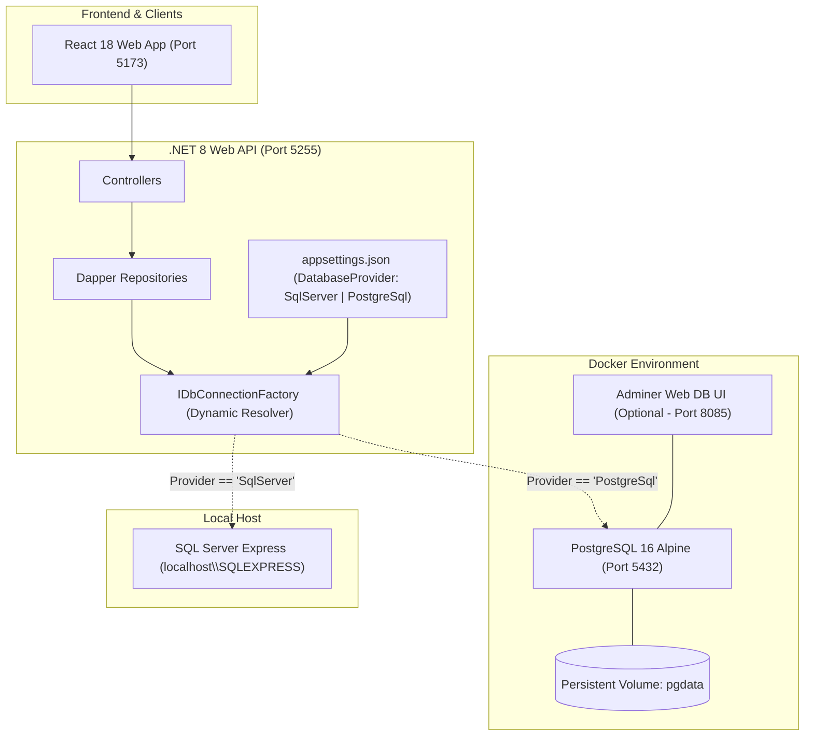

# Comprehensive Migration Plan: SQL Server to PostgreSQL in Docker with Dynamic Provider Switching

> **Status:** 📋 PROPOSED — Awaiting User Approval  
> **Target Date:** October 2026  
> **Source Database:** SQL Server Backup `docs/2025_AgriPHD_Live_20260817/2025_AgriPHD_Live_20260817.bak` & Active Database `localhost\SQLEXPRESS` (`2025_AgriPHD_Live`)  
> **Target Database:** PostgreSQL 16 (Alpine) running in Docker container (`agriphd-postgres`)  
> **Backend Integration:** .NET 8 Web API (`AgriPhd.Api`) with Dynamic Database Provider Switching (`SqlServer` ⟷ `PostgreSql`)

---

## 1. Executive Summary & Current State Assessment

### 1.1 Database File & Active Instance Audit
- **Backup File Location:** `docs/2025_AgriPHD_Live_20260817/2025_AgriPHD_Live_20260817.bak`
- **File Size:** ~61.76 MB (Compressed backup; uncompressed data ~101.38 MB, log ~10.62 MB).
- **Active Live Database:** Currently running locally on `localhost\SQLEXPRESS`, catalog `2025_AgriPHD_Live`.
- **Database Metrics:**
  - **Tables:** 223 user tables.
  - **Total Rows:** 219,048 total rows (modest dataset; largest tables have ~13.3k and ~9.6k rows).
  - **Total Stored Procedures in DB:** 272 routines.
  - **Stored Procedures Actively Used by .NET API:** **103 stored procedures** across 12 C# Dapper repositories (`AuthRepository`, `ApplicationFormRepository`, `AdminRepository`, `RegistrationRepository`, `FeeRepository`, etc.).

### 1.2 Docker Infrastructure Audit
- **Docker Desktop Version:** 4.97.0 (Engine 29.9.2, Compose v5.6.1) is installed and active on the machine via WSL2.
- **Port Availability:** Standard PostgreSQL port `5432` is available.

### 1.3 Key Technical Challenge: Stored Procedures & Dapper Execution
The `AgriPhd.Api` backend exclusively uses Dapper with `CommandType.StoredProcedure` and `@ParameterName` syntax.
- SQL Server supports `EXEC [ProcedureName] @param=val` natively returning result sets.
- PostgreSQL differentiates between `PROCEDURE` (`CALL proc()`) and `FUNCTION` (`SELECT * FROM func()`).
- In addition, T-SQL functions (`ISNULL`, `GETDATE`, `SCOPE_IDENTITY`, `TOP 1`, identity columns) require semantic translation to PostgreSQL standards (`COALESCE`, `NOW()`, `GENERATED ALWAYS AS IDENTITY`, `LIMIT 1`).

---

## 2. Target Architecture



---

## 3. Data & Schema Type Mapping Specification

| SQL Server Data Type | PostgreSQL Data Type | Migration Strategy / Handling |
|---|---|---|
| `INT`, `BIGINT`, `SMALLINT`, `TINYINT` | `INTEGER`, `BIGINT`, `SMALLINT`, `SMALLINT` | Exact numeric mapping; `TINYINT` maps to `SMALLINT`. |
| `BIT` | `BOOLEAN` (or `SMALLINT`) | `BOOLEAN` in PG. Dapper maps `bool` and `int` transparently. |
| `NVARCHAR(n)`, `VARCHAR(n)` | `VARCHAR(n)` | Exact length preserved; UTF-8 native in PostgreSQL. |
| `NTEXT`, `TEXT` | `TEXT` | Variable length text. |
| `DATETIME`, `DATETIME2`, `SMALLDATETIME` | `TIMESTAMP WITHOUT TIME ZONE` | Preserves exact wall-clock datetime without UTC timezone shifting. |
| `DECIMAL(p,s)`, `NUMERIC(p,s)`, `MONEY` | `NUMERIC(p,s)` | Precision and scale retained exactly. |
| `IDENTITY(1,1)` | `BIGINT GENERATED ALWAYS AS IDENTITY` (or `BIGSERIAL`) | Primary key sequence created; sequences reset to `MAX(id) + 1` post-migration. |
| `UNIQUEIDENTIFIER` | `UUID` | Direct conversion or `VARCHAR(36)`. |
| `VARBINARY(MAX)`, `IMAGE` | `BYTEA` | Binary blobs mapped directly. |

---

## 4. Phase-by-Phase Implementation Plan

### Phase 1: Docker Environment Setup
1. **Create Docker Compose configuration:**
   - File: `docker-compose.db.yml` at project root.
   - Services:
     - `postgres`: Image `postgres:16-alpine`, port `5432:5432`, environment variables for `POSTGRES_DB`, `POSTGRES_USER`, `POSTGRES_PASSWORD`.
     - Named volume: `agriphd_pgdata` for persistent storage across container restarts.
     - Optional lightweight web manager: `adminer:latest` on port `8085` for easy browser-based database inspection.
   - File: `.env.db` (git-ignored) with local container credentials.
2. **Verify container health:**
   - Start container: `docker compose -f docker-compose.db.yml up -d`
   - Validate connectivity via `psql` / TCP connection test.

### Phase 2: Schema Migration (DDL Generation)
1. **Extract Schema from SQL Server `2025_AgriPHD_Live`:**
   - Create an automated schema extractor script (`tools/migration/extract_schema.ps1` or Python migration utility).
   - Generates PostgreSQL-compliant DDL scripts:
     - `01_tables.sql`: 223 tables with mapped data types and default values.
     - `02_primary_keys.sql`: All PK constraints and auto-increment identity definitions.
     - `03_foreign_keys.sql`: Referential integrity constraints.
     - `04_indexes.sql`: Non-clustered indexes.
2. **Execute DDL on PostgreSQL Container:**
   - Run DDL against `agri_phd_live` database in Docker.
   - Verify all 223 tables exist with matching columns and primary keys.

### Phase 3: Automated Data Extraction & Loading (ETL)
1. **Create Bulk Migration Script:**
   - Fast streaming script (`tools/migration/migrate_data.py` or .NET migration console app):
     - Connects simultaneously to SQL Server (`localhost\SQLEXPRESS`) and PostgreSQL (`localhost:5432`).
     - Disables foreign key checks temporarily during load (`SET session_replication_role = 'replica';`).
     - Streams all 223 tables (~219,048 rows total) in chunked batches.
     - Re-enables foreign key checks (`SET session_replication_role = 'origin';`).
2. **Sequence / Identity Synchronization:**
   - Run sequence synchronization script for all tables with identity columns:
     ```sql
     SELECT setval(pg_get_serial_sequence('table_name', 'id_col'), COALESCE(MAX(id_col), 1)) FROM table_name;
     ```
3. **Data Integrity & Row Count Verification:**
   - Run automated row-count validator comparing SQL Server vs PostgreSQL row-for-row.
   - Spot-check critical core tables: `ApplicationForm_PersonalDetails`, `ApplicationForm_RegisteredCandidate`, `Master_Course`, `Master_College`, `Menu_Links`.

### Phase 4: Stored Procedures & Functions Porting (PL/pgSQL)
1. **Scope of Porting:**
   - Focus specifically on the **103 stored procedures** actively executed by `AgriPhd.Api`.
2. **Translation Strategy:**
   - Create SQL migration script `05_procedures.sql` defining PostgreSQL compatibility routines:
     - Procedures/Functions matching exact names (e.g. `Account_CheckUserExists`, `Menu_GetMenu`, `Administration_GetUsersList`, `Admission_GetAllotmentSummary`, etc.).
     - T-SQL syntax converted to PL/pgSQL:
       - `ISNULL(x, y)` ➔ `COALESCE(x, y)`
       - `GETDATE()` ➔ `CURRENT_TIMESTAMP` / `clock_timestamp()`
       - `TOP (n)` ➔ `LIMIT n`
       - Parameter names `@ParamName` preserved.
       - Output queries returning tabular data written as `RETURNS TABLE(...)` or `RETURNS refcursor` / procedures with result sets.

### Phase 5: Dynamic Database Provider in `AgriPhd.Api`
1. **Add PostgreSQL Driver:**
   - Add NuGet package `Npgsql` (v8.x) to `AgriPhd.Api`.
2. **Design Dynamic Connection Factory & Abstraction:**
   - Create interface `IDbConnectionFactory`:
     ```csharp
     public interface IDbConnectionFactory
     {
         IDbConnection CreateConnection();
         DatabaseProvider CurrentProvider { get; }
     }
     ```
   - Implement `DbConnectionFactory`:
     - Reads `DatabaseProvider` from configuration.
     - Returns `new SqlConnection(...)` when `DatabaseProvider == "SqlServer"`.
     - Returns `new NpgsqlConnection(...)` when `DatabaseProvider == "PostgreSql"`.
3. **Repository Execution Compatibility Layer:**
   - Ensure Dapper calls work seamlessly across both providers:
     - Npgsql natively supports named parameters (`@UserLoginID`).
     - Handle procedure/function execution dialect differences cleanly via a lightweight helper or extension without rewriting existing repository business logic.
4. **Configuration in `appsettings.json` & `appsettings.Development.json`:**
   ```json
   {
     "DatabaseProvider": "PostgreSql", // Change to "SqlServer" at any time to switch back!
     "ConnectionStrings": {
       "SqlServer": "Data Source=localhost\\SQLEXPRESS;Initial Catalog=2025_AgriPHD_Live;Integrated Security=True;TrustServerCertificate=True",
       "PostgreSql": "Host=localhost;Port=5432;Database=agri_phd_live;Username=postgres;Password=postgres;Include Error Detail=true;"
     }
   }
   ```
5. **Health Checks:**
   - Update `/health` endpoint to report:
     - Active database provider (`SqlServer` or `PostgreSql`).
     - Connection latency and database version.

### Phase 6: End-to-End Testing & Verification
1. **API Integration Tests:**
   - Run `AgriPhd.Tests` against PostgreSQL.
   - Test key workflows:
     - Authentication (`Account_CheckUserExists`, `Account_GetLoggedInUserDetails`).
     - Dynamic Menu Generation (`Menu_GetMenu`).
     - Master Data retrieval (`Master_College`, `Master_Course`).
     - Candidate Application Form steps.
     - Admin dashboard & user management.
2. **Frontend UI Smoke Test:**
   - Run Vite frontend against API running with `DatabaseProvider: "PostgreSql"`.
   - Verify candidate login, admin login, menu rendering, and form submission.
3. **Zero-Downtime Provider Switch Test:**
   - Flip `DatabaseProvider` to `"SqlServer"` ➔ verify everything works identically.
   - Flip `DatabaseProvider` to `"PostgreSql"` ➔ verify everything works identically.

---

## 5. Rollback & Risk Mitigation Strategy

| Risk | Mitigation |
|---|---|
| **Data divergence during migration** | Source SQL Server database is **read-only** during migration; original database and `.bak` file remain completely untouched. |
| **Instant Rollback Requirement** | By changing `"DatabaseProvider": "SqlServer"` in `appsettings.json`, the API immediately switches back to the existing SQL Server without needing code recompilation or rebuilds. |
| **PostgreSQL container crash or restart** | Container uses a Docker persistent volume (`agriphd_pgdata`), ensuring data persists across restarts and machine reboots. |
| **T-SQL procedure behavioral differences** | Stored procedures are tested 1-to-1 against equivalent SQL Server results using automated test cases before switching the default provider. |

---

## 6. Project Deliverables

1. `docker-compose.db.yml` & `.env.db.example` — PostgreSQL 16 container definition.
2. `tools/migration/` — Automated extraction and data migration scripts.
3. `tools/migration/sql/` — DDL and PL/pgSQL procedures scripts.
4. `AgriPhd.Api/` updates — `IDbConnectionFactory`, `Npgsql` driver, dynamic provider configuration in `appsettings.json`.
5. `docs/MIGRATION_VERIFICATION_REPORT.md` — Detailed verification report with row counts, timing, and test results.

---

## 7. Approval & Next Steps

This plan will remain in proposal status until you review and approve it.
Once approved, execution will begin starting with **Phase 1 (Docker Environment Setup)** and **Phase 2 (Schema Extraction)**.
